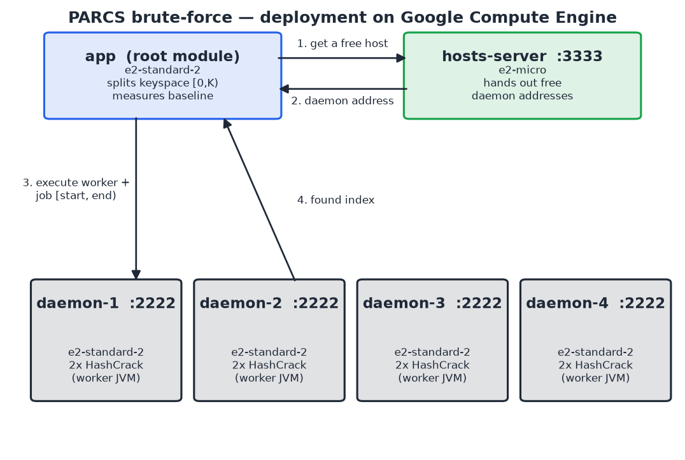
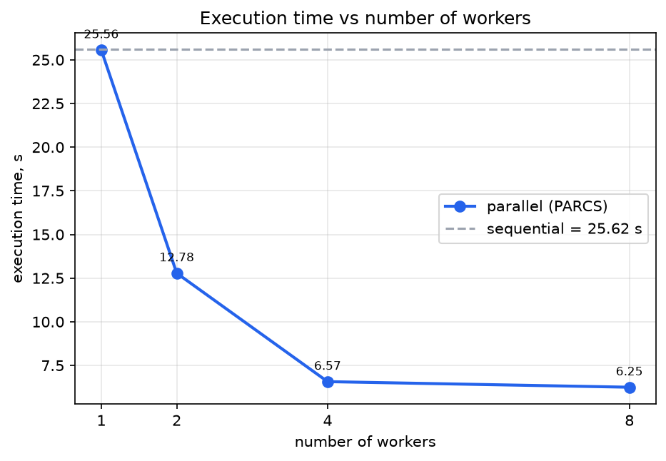
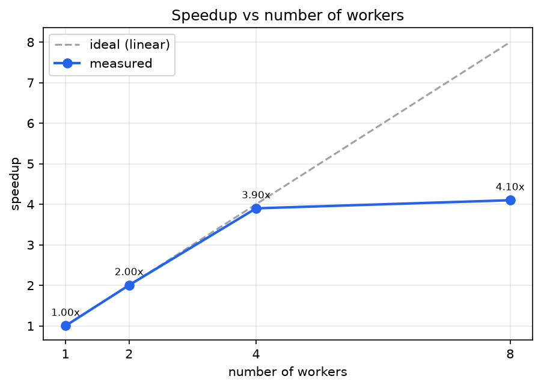

# PARCS brute-force — parallel password recovery on PARCS-Java

Laboratory work for the *Cloud Computing* course, variant **7.6 — Parallel
brute-force for password cracking**.

The program recovers a fixed-length password from its hash by scanning the whole
keyspace in parallel on a [PARCS-Java](https://github.com/lionell/labs/tree/master/parcs)
cluster deployed on Google Compute Engine. It is an educational demonstration of
parallel speed-up: the target hash is generated by the program itself from a
password it chooses, and the point of interest is how execution time scales with
the number of workers, not attacking anyone's credentials.

* **Task 1** — the parallel algorithm on PARCS-Java + GCP (this is the core).
* **Task 2** — the *same* cluster deployed through the Compute Engine **API** in
  Python, with no `gcloud` and no `ssh` (see [`cloud/`](cloud/)).

## Idea

Every password of length *L* over a charset of size *B* is identified with an
integer index in `[0, K)`, where `K = B^L`. Recovering the password is therefore
a scan of `[0, K)`:

* the **root module** (`app`) splits `[0, K)` into equal contiguous slices, one
  per worker, and measures the sequential baseline;
* each **worker** (`HashCrack`) scans its own slice independently — turning each
  index into a candidate string, hashing it, and comparing with the target — and
  returns the matching index (or −1);
* the root reconstructs the password and verifies it against the baseline.

Communication happens only twice (slice out, index back), so network cost is
constant while each worker does hundreds of millions of hash operations — which
is exactly why the task parallelizes well.



## Repository layout

| What | Where |
|------|-------|
| root module + worker | `src/BruteForce.java`, `src/HashCrack.java` |
| PARCS library + nodes | `out/parcs.jar`, `out/Daemon.jar`, `out/TCPHostsServer.jar` |
| build | `Makefile` |
| run parameters | `out/input` |
| hosts-server address | `out/server` |
| one-command GCP deploy (bash) | `deploy/gcloud-all.sh` |
| Compute Engine API deploy (Task 2) | `cloud/parcs_cloud.py`, `cloud/startup/` |
| figures + measurements | `results/` |

## Build & run locally (Windows)

No `make` is needed; `out/` already contains `parcs.jar`, `Daemon.jar` and
`TCPHostsServer.jar`.

```bash
# 1. compile
javac -encoding UTF-8 -cp out/parcs.jar -d build src/*.java
jar cf out/HashCrack.jar  -C build .
jar cf out/BruteForce.jar -C build .

# 2. start one daemon and the hosts-server (out/hosts.list = localhost)
cd out
java -jar Daemon.jar &
java -jar TCPHostsServer.jar &

# 3. run (reads out/server = localhost and out/input)
java -cp "parcs.jar;BruteForce.jar" BruteForce
```

On Linux use `make run` (classpath separator `:`).

Parameters live in `out/input`:

```
algo=SHA-256
charset=abcdefghijklmnopqrstuvwxyz0123456789
length=5
password=99999          # the program hashes this and then cracks the hash
workers=1 2 4 8         # every configuration runs in a single launch
repeats=3
```

The password is the last candidate of the keyspace, so every run scans the full
range and the timings are reproducible.

## Deploy to Google Cloud

**Option A — one bash script** (creates app + hosts-server + 4 daemons):

```bash
# edit REPO inside the script to your fork first
bash deploy/gcloud-all.sh
```

**Option B — Compute Engine API, Python** (Task 2):

```bash
cd cloud
pip install -r requirements.txt
python parcs_cloud.py            # create -> compute -> delete
python parcs_cloud.py --plan     # dry run: print the planned API requests
python parcs_cloud.py --delete   # tear down anything left tagged parcs=1
```

Delete the machines when finished — a VM is billed just for existing.

## Results (local, 6-core / 12-thread machine)

Sequential baseline: **15.76 s**, keyspace `K = 36^5 = 60 466 176`.

| workers | best, s | speedup | efficiency |
|--------:|--------:|--------:|-----------:|
| 1 | 15.78 | 1.00× | 99.9 % |
| 2 | 7.42 | 2.12× | 106.2 % |
| 4 | 3.83 | 4.11× | 102.9 % |
| 8 | 2.53 | 6.22× | 77.7 % |




Near-linear up to 4 workers; at 8 the speed-up tapers because the workers, the
daemon JVMs, the hosts-server and the root module together saturate the
available cores and each worker is a separate JVM with a fixed start-up cost.
